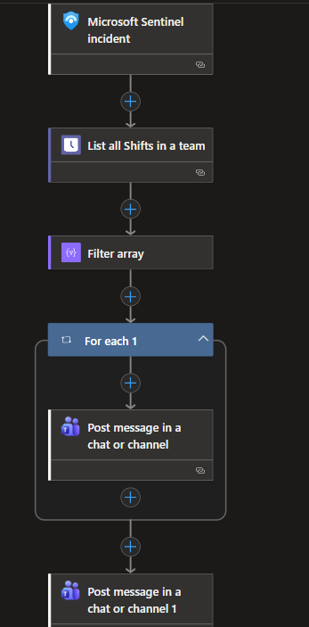

**SIEM Automation Playbooks**
This repository contains automation playbooks applied in SIEM solutions.

**📘 TeamMessage_FOR_HighSeverityIncidents**
A Microsoft Sentinel playbook that triggers automatically when a high severity incident (filterd by automation rule condition) is ingested from any of the following Microsoft Defender products:

Microsoft Defender for Endpoint
Microsoft Defender for Identity
Microsoft Defender for Cloud Apps
Microsoft Defender XDR

Upon trigger, the playbook connects to Microsoft Teams Shifts to identify the currently active employees on shift. It then extracts each user's account ID and sends a Teams direct message notifying all on-shift employees as well as the team manager about the incident.

📄 For full configuration details, see [Configuration](./TeamMessage_FOR_HighSeverityIncidents)

**📘 Block Phishing Sender Domain**
A Microsoft Sentinel playbook that triggers automatically when incident for email message from phishing domain that match confident Threat Intelligence feeds is ingested from Microsoft Sentinel analytic rule.

the playbook extracts the email network message Id and the recipient address name and then use specific Microsoft Graph API "https://graph.microsoft.com/v1.0/security/collaboration/analyzedEmails/remediate" to apply soft deletion for the email message.

📄 For full configuration details, see [Configuration](./Block_Phishing_Domain)

**📘 Claude Compliane API Data Ingestion**
A blank Microsoft Sentinel playbook that recurs every 5 minutes, ingesting Anthropic Claude Enterprise logs.

The Logic App sends HTTP requests using the Claude Compliance API to fetch all events related to Claude Enterprise, and then ingests them into a Microsoft Sentinel table.

The ingestion mechanism works as follows: each request fetches one page of Claude Compliance data and returns a continuation token in the response. This token must be stored and used as a header in the playbook’s next trigger to fetch new data from the Claude Compliance API.,

📄 For full configuration details, see [Configuration](./Block_Phishing_Domain)

**📘 Doverunner-Integration**
A Microsoft Sentinel Logic App used to fetch security events from a DoveRunner Amazon S3 bucket.

The bucket contents are first listed to get all the files in the bucket (Android devices/iOS devices). Then the most recently generated compressed files for both iOS and Android are retrieved to get their contents. Finally, the events are ingested into a Microsoft Sentinel Log Analytics workspace table.

📄 For full configuration details, see [Configuration](./DoveRunnner_Data_Ingestion)
